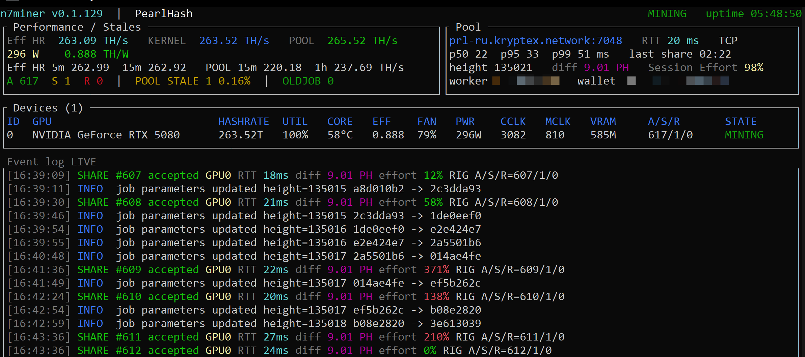
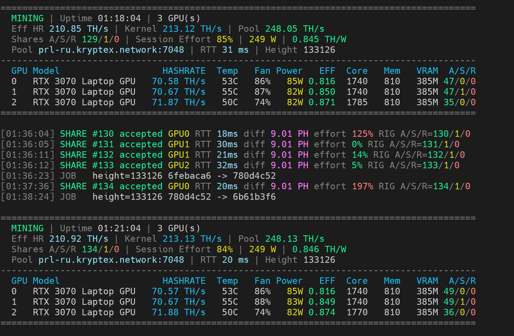

# N7Miner

**[Русский](README.md) · [English](README.en.md)**

N7Miner mines PearlHash on NVIDIA and AMD GPUs. It runs on Windows, Linux and HiveOS, whether you have a single card, a multi-GPU rig or a mix of NVIDIA and AMD.

**Windows x64 · Linux x64 · HiveOS · Developer fee: 1%**

## What's new in 0.1.130

- **AutoOC:** automatic tuning of a stable Core Clock Offset for NVIDIA GPUs. [Setup guide](docs/AUTOOC.en.md).
- Minor bug fixes.

## Download

| Platform | Package |
| --- | --- |
| Windows x64 | [N7Miner 0.1.130 for Windows](https://github.com/Nigh7man/N7Miner-Releases/releases/download/v0.1.130/N7Miner-v0.1.130-universal-windows-x64.zip) |
| Linux x64 | [N7Miner 0.1.130 for Linux](https://github.com/Nigh7man/N7Miner-Releases/releases/download/v0.1.130/N7Miner-v0.1.130-universal-linux-x64.tar.gz) |
| HiveOS | [N7Miner 0.1.130 for HiveOS](https://github.com/Nigh7man/N7Miner-Releases/releases/download/v0.1.130/n7miner-0.1.130_universal_hive_x64.tar.gz) |

[All releases](https://github.com/Nigh7man/N7Miner-Releases/releases) · [Latest release](https://github.com/Nigh7man/N7Miner-Releases/releases/latest)

Verify each archive with [SHA256SUMS.txt](https://github.com/Nigh7man/N7Miner-Releases/releases/download/v0.1.130/SHA256SUMS.txt).

# Features

- Runs NVIDIA and AMD GPUs together in one rig.
- Shows hashrate, temperature, power draw and share counts for each GPU.
- Includes an interactive TUI and a regular scrolling console mode.
- Can switch to backup pools when the primary pool isn't available.
- Offers GPU core and memory clock settings, including per-GPU settings and optional reset on exit.
- Includes startup and network checks.

## AutoOC

The new `--autooc` option tunes the NVIDIA GPU core offset while the core clock is locked. Each GPU is tuned independently: the miner raises the offset in small steps, falls back on faults and saves the result.

On HiveOS, set **Lock Core Clock** and a starting **Core Clock**, then add `--autooc` under `Extra config arguments`. On Windows, use `--cclock`, `--coffset` and `--autooc`.

**For PRL, we recommend locking GPU memory to 810 MHz for better power efficiency** on supported cards.

**[AutoOC guide in English: setup, tuning stages, status icons, faults and reset](docs/AUTOOC.en.md)**

## Screenshots

### TUI

*Screenshot from the previous version (0.1.129). AutoOC UI indicators are explained in the separate guide.*

Give `Eff HR` around 10–15 minutes of mining before relying on the number.

### Console mode

For plain console output:

~~~bash
n7miner --notui --log-interval 180
~~~

## Quick start

### Windows

Extract the ZIP, open the BAT file for your pool and enter your wallet address. Or run the miner yourself:

~~~bat
n7miner.exe -a pearlhash -o prl-ru.kryptex.network:7048 -u YOUR_WALLET -w rig01 -p x -d auto
~~~

Replace `YOUR_WALLET` with your Pearl wallet address. You can change the worker name `rig01`.

For a mixed NVIDIA + AMD rig:

~~~bat
n7miner.exe -a pearlhash -o prl-ru.kryptex.network:7048 -u YOUR_WALLET -w rig01 --devices all --amd-devices all
~~~

### HiveOS

Use the HiveOS Custom Miner package. Ready-to-import pool settings are in the [HiveOS setup guide](docs/HIVEOS.md).

See the [command-line reference](docs/CLI.md) for the full set of options, clock controls and diagnostic commands.

## Tested GPUs and hashrates

Tested on the following GPUs:

| GPU | Hashrate |
| --- | ---: |
| NVIDIA GeForce RTX 5080 | ~263 TH/s |
| NVIDIA GeForce RTX 3080 Ti | ~152 TH/s |
| NVIDIA GeForce RTX 3080 | ~130 TH/s |
| NVIDIA CMP 90HX | ~99 TH/s |
| NVIDIA GeForce RTX 3070 | ~90 TH/s |
| NVIDIA GeForce RTX 3070 Ti Laptop GPU | ~81 TH/s |
| NVIDIA GeForce RTX 3070 Laptop GPU | ~71 TH/s |
| AMD Radeon RX 6600 XT | ~11 TH/s |
| AMD Radeon RX 6600M | ~8 TH/s |
| AMD Radeon RX 5700 XT | ~5 TH/s |

Results depend on the card, clock settings, power, cooling and drivers.

## Verify your download

Compare the downloaded archive's SHA-256 with `SHA256SUMS.txt` in the matching release. Replace the placeholder with the filename you downloaded:

**Windows:** `Get-FileHash .\N7Miner-v0.1.130-universal-windows-x64.zip -Algorithm SHA256`

**Linux:** `sha256sum N7Miner-v0.1.130-universal-linux-x64.tar.gz`

Having trouble? [Open an issue](https://github.com/Nigh7man/N7Miner-Releases/issues) with the version, GPU, driver, pool and relevant log output. Don't post passwords or private keys.

N7Miner is provided "as is", without any warranties.
