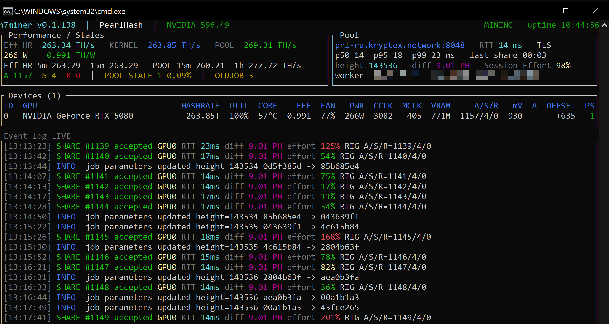
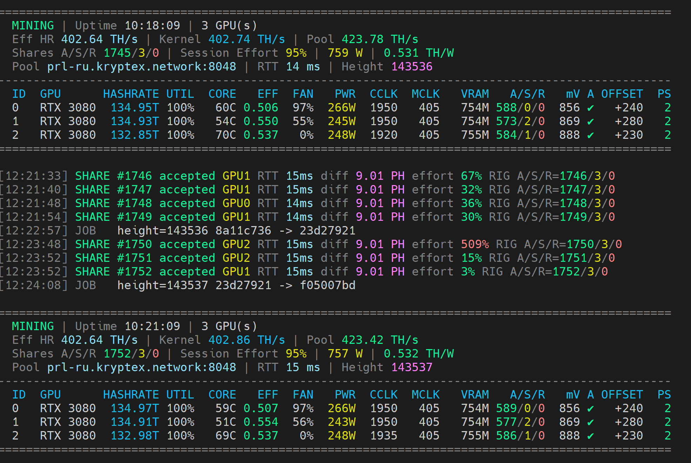

# N7Miner

**[Русский](README.md) · [English](README.en.md)**

N7Miner mines PearlHash on NVIDIA and AMD GPUs. It runs on Windows, Linux and HiveOS, whether you have a single card, a multi-GPU rig or a mix of NVIDIA and AMD.

**Windows x64 · Linux x64 · HiveOS · Developer fee: 1%**

## What's new in 0.1.139

- **Ampere (SM86 / RTX 30 series):** minor mining power-efficiency improvement.
- **AutoOC:** reworked calculation-error handling and per-GPU recovery.
- **Bug fixes:** stability and reliability improvements.

## Download

| Platform | Package |
| --- | --- |
| Windows x64 | [N7Miner 0.1.139 for Windows](https://github.com/Nigh7man/N7Miner-Releases/releases/download/v0.1.139/N7Miner-v0.1.139-universal-windows-x64.zip) |
| Linux x64 | [N7Miner 0.1.139 for Linux](https://github.com/Nigh7man/N7Miner-Releases/releases/download/v0.1.139/N7Miner-v0.1.139-universal-linux-x64.tar.gz) |
| HiveOS | [N7Miner 0.1.139 for HiveOS](https://github.com/Nigh7man/N7Miner-Releases/releases/download/v0.1.139/n7miner-0.1.139_universal_hive_x64.tar.gz) |

[All releases](https://github.com/Nigh7man/N7Miner-Releases/releases) · [Latest published release](https://github.com/Nigh7man/N7Miner-Releases/releases/latest)

**News and updates:** [N7Miner Telegram channel](https://t.me/N7Miner).

Verify each archive with [SHA256SUMS.txt](https://github.com/Nigh7man/N7Miner-Releases/releases/download/v0.1.139/SHA256SUMS.txt).

# Features

- **Honest, verifiable hashrate:** compare the miner's effective hashrate with pool-side statistics over a long enough interval; short-term pool estimates fluctuate.
- **Transparent 1% developer fee:** no additional hidden miner charges. Any pool fee is separate.
- **Optimized host-side processing:** low-latency share handling and submission help reduce rejected and stale shares. Network and pool conditions also matter.
- **NVIDIA and AMD:** single-GPU, multi-GPU and mixed-vendor rigs.
- **NVIDIA Power Save:** `--ps 0`–`--ps 3` profiles to reduce GPU power consumption. **Our testing has shown the largest benefit on RTX 50-series GPUs**, such as RTX 5080. [Setup guide](docs/POWER-SAVE.en.md).
- **AutoOC:** automatic NVIDIA core clock offset tuning, with per-GPU saved settings. [Guide](docs/AUTOOC.en.md).
- **GPU clock and power controls:** locked core/memory clocks, offsets and GPU Power Limit in watts or percentages via CLI; settings restored on normal exit where applicable.
- **Secure Stratum TLS:** encrypted pool connections with certificate validation by default, plus automatic failover to backup pools.
- **Monitoring:** interactive TUI, scrolling console, per-GPU hashrate, temperature, power, efficiency and share statistics; `A`, `OFFSET` and `PS` columns. Read-only local status API.
- **Reliability and diagnostics:** watchdog, startup/network checks and event logs.
- **HiveOS CMP unlock:** experimental compatibility checks, compute unlock for supported CMP cards and stock driver restore. [Guide](docs/CMP-HIVEOS.en.md).

## Power Save

NVIDIA Power Save is available for Windows, Linux and HiveOS. Enable it with `--ps 1` (levels `0`–`3`). **The most noticeable benefit in our testing has been on RTX 50-series GPUs.** Linux/HiveOS requires `root` privileges. [Power Save guide](docs/POWER-SAVE.en.md).

**NVIDIA drivers tested with Power Save:** HiveOS — `610.43.03`, `615.71.10`; Windows — `596.49`, `621.24`. Testing on these versions does not guarantee compatibility with every GPU model.

## AutoOC

The `--autooc` option tunes the NVIDIA GPU core offset while the core clock is locked. Each GPU is tuned independently: the miner raises the offset in small steps, falls back on faults and saves the result. In v0.1.139, wrong-result handling and per-GPU recovery have been reworked.

On HiveOS, set **Lock Core Clock** and a starting **Core Clock**, then add `--autooc` under `Extra config arguments`. On Windows, use `--cclock`, `--coffset` and `--autooc`.

**For PRL, a 405 MHz memory lock is preferred for power efficiency when supported by the GPU and driver; otherwise use 810 MHz.**

**[AutoOC guide in English: setup, tuning stages, status icons, faults and reset](docs/AUTOOC.en.md)**

## Screenshots

### TUI

Give `Eff HR` around 10–15 minutes of mining before relying on the number.

### Console mode

For plain console output:

~~~bash
n7miner --notui --log-interval 180
~~~

## Quick start

### Windows

Extract the ZIP, open the BAT file for your pool and enter your wallet address. Or run the miner yourself:

~~~bat
n7miner.exe -a pearlhash -o prl-ru.kryptex.network:7048 -u YOUR_WALLET -w rig01 -p x -d auto
~~~

Replace `YOUR_WALLET` with your Pearl wallet address. You can change the worker name `rig01`.

For a mixed NVIDIA + AMD rig:

~~~bat
n7miner.exe -a pearlhash -o prl-ru.kryptex.network:7048 -u YOUR_WALLET -w rig01 --devices all --amd-devices all
~~~

### HiveOS

Use the HiveOS Custom Miner package. Ready-to-import pool settings are in the [HiveOS setup guide](docs/HIVEOS.md).

See the [command-line reference](docs/CLI.md) for the full set of options, clock controls and diagnostic commands.

## Tested GPUs and hashrates

Updated measurements on N7Miner 0.1.138 test builds, November 15, 2026:

| GPU | Hashrate | GPU power |
| --- | ---: | ---: |
| NVIDIA GeForce RTX 5080 | ~263 TH/s | ~266 W |
| NVIDIA GeForce RTX 3080 Ti | ~151–160.1 TH/s | ~253–323 W |
| NVIDIA GeForce RTX 3080 | ~133–135 TH/s | ~247–263 W |
| NVIDIA CMP 90HX | ~106.9 TH/s | ~246 W |
| NVIDIA GeForce RTX 3070 | ~89 TH/s | ~161 W |
| NVIDIA GeForce RTX 3070 Ti Laptop GPU | ~82 TH/s | ~75 W |
| NVIDIA GeForce RTX 3070 Laptop GPU | ~72–75 TH/s | ~82–115 W |
| NVIDIA RTX A3000 Laptop GPU | ~55.3 TH/s | ~119 W |
| AMD Radeon RX 6600 XT | ~11.5 TH/s | ~60 W |
| AMD Radeon RX 6600M | ~9.5 TH/s | ~50 W |
| AMD Radeon RX 5700 XT | ~3.9 TH/s | ~105 W |

## Verify your download

Compare the downloaded archive's SHA-256 with `SHA256SUMS.txt` in the matching release. Replace the placeholder with the filename you downloaded:

**Windows:** `Get-FileHash .\N7Miner-v0.1.139-universal-windows-x64.zip -Algorithm SHA256`

**Linux:** `sha256sum N7Miner-v0.1.139-universal-linux-x64.tar.gz`

Having trouble? [Open an issue on GitHub](https://github.com/Nigh7man/N7Miner-Releases/issues) or leave a comment in the [N7Miner Telegram channel](https://t.me/N7Miner). Include your miner version, GPU model, driver, pool and relevant log output. Don't post passwords or private keys.

N7Miner is provided "as is", without any warranties.
