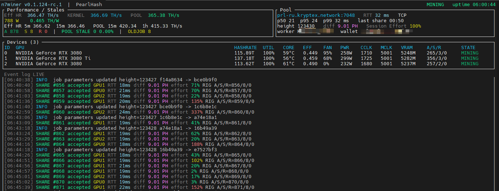
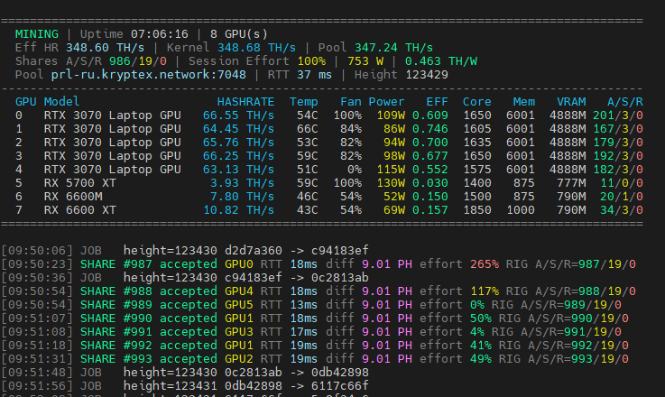

# N7Miner

**PearlHash GPU miner for NVIDIA and AMD**

N7Miner is a purpose-built PearlHash miner focused on sustained performance, power efficiency and reliable pool mining. It supports individual GPUs, multi-GPU systems and mixed NVIDIA + AMD mining rigs.

**Windows x64 · Linux x64 · HiveOS**  
**NVIDIA + AMD · Multi-GPU · 2% developer fee**

[**Download latest public release**](https://github.com/Nigh7man/N7Miner-Releases/releases/latest) · [All releases](https://github.com/Nigh7man/N7Miner-Releases/releases) · [Report an issue](https://github.com/Nigh7man/N7Miner-Releases/issues)

> **v0.1.128 preview:** This README is prepared for the upcoming v0.1.128 release. The release is currently a draft, so its download links will only work after publication. The latest public version remains v0.1.124-rc.1.

## Download v0.1.128

| Platform | Package |
| --- | --- |
| Windows x64 | [N7Miner-v0.1.128-universal-windows-x64.zip](https://github.com/Nigh7man/N7Miner-Releases/releases/download/v0.1.128/N7Miner-v0.1.128-universal-windows-x64.zip) |
| Linux x64 | [N7Miner-v0.1.128-universal-linux-x64.tar.gz](https://github.com/Nigh7man/N7Miner-Releases/releases/download/v0.1.128/N7Miner-v0.1.128-universal-linux-x64.tar.gz) |
| HiveOS | [n7miner-0.1.128_universal_hive_x64.tar.gz](https://github.com/Nigh7man/N7Miner-Releases/releases/download/v0.1.128/n7miner-0.1.128_universal_hive_x64.tar.gz) |

**Always download binaries from the official N7Miner Releases repository.** SHA-256 checksums are provided with each release for verifying downloads.

## Why N7Miner?

### Performance & efficiency

- PearlHash-specific mining kernels with GPU architecture-aware execution paths.
- Support for NVIDIA and AMD GPUs in the same rig.
- Per-GPU monitoring and flexible hardware selection.
- Performance optimization focused on sustained mining workloads.

### Real-world monitoring

- Interactive terminal interface (TUI).
- Lightweight scrolling console mode for remote/headless systems.
- Per-GPU hashrate and hardware telemetry.
- Effective pool hashrate and session-effort statistics.
- Accepted, rejected and stale share counts.

### Reliability & control

- Priority-ordered pool failover.
- GPU core and memory clock configuration, including per-GPU values.
- Optional restoration of miner-applied GPU clocks on exit.
- Built-in integrity and connectivity self-check options.
- Universal packages for Windows, Linux and HiveOS.

## Interface Preview

**Note:** Pool-side effective hashrate (`Eff HR`) needs approximately **10–15 minutes** of continuous mining to become representative.

### Console mode

To run without the interactive dashboard:

~~~bash
n7miner --notui --log-interval 180
~~~

## Quick Start

### Windows

Download the Windows ZIP archive, extract it, and launch a bundled pool starter after replacing the wallet placeholder, or use the CLI:

~~~bat
n7miner.exe -a pearlhash -o prl-ru.kryptex.network:7048 -u YOUR_WALLET -w rig01 -p x -d auto
~~~

Replace `YOUR_WALLET` with your Pearl wallet address. Adjust `rig01` to your preferred worker name.

### Mixed NVIDIA + AMD rig

~~~bat
n7miner.exe -a pearlhash -o prl-ru.kryptex.network:7048 -u YOUR_WALLET -w rig01 --devices all --amd-devices all
~~~

### HiveOS

Use the N7Miner Custom Miner package. Create a PRL wallet, configure the pool and miner in a Flight Sheet, then apply it to your rig.

**[HiveOS setup and importable Flight Sheets →](docs/HIVEOS.md)**

### Advanced configuration

**[Command-line options, clock control, diagnostics and failover →](docs/CLI.md)**

## GPU Compatibility

N7Miner supports multiple NVIDIA and AMD GPU architectures. GPUs tested on N7Miner development rigs include:

| NVIDIA | AMD |
| --- | --- |
| GeForce RTX 5080 | Radeon RX 5700 XT |
| GeForce RTX 3080 Ti | Radeon RX 6600 XT |
| GeForce RTX 3080 | Radeon RX 6600M |
| GeForce RTX 3070 / 3070 Laptop GPU | |
| GeForce RTX 3070 Ti Laptop GPU | |
| CMP 90HX | |

Further compatible models may operate using supported architecture paths. Actual performance varies with drivers, power limits, clocks, cooling and individual GPUs.

**[Supported GPUs and historical test results →](docs/SUPPORTED-GPUS.md)**

## Developer Fee

The public production build includes a **2% developer fee** to support ongoing development, kernel optimization, compatibility testing and maintenance.

There is no subscription fee.

## Verification & Diagnostics

- `--self-check` — verify production startup integrity without starting GPU workers.
- `--self-check-network` — check production service connectivity without mining.
- `--no-submit` — run a non-submitting test.
- `--help` / `--version` — list available options and print the installed version.

Verify release downloads against the included `SHA256SUMS.txt` before use.

### Verify on Windows

~~~powershell
Get-FileHash .\n7miner.exe -Algorithm SHA256
~~~

### Verify on Linux

~~~bash
sha256sum ./n7miner
~~~

## Feedback & Issues

Please [open an issue](https://github.com/Nigh7man/N7Miner-Releases/issues) with the miner version, operating system, GPU model(s), driver version, pool, relevant command-line options and a reproducible log excerpt.

**Never include private keys, passwords or other credentials in issue reports.**

## Distribution

N7Miner is proprietary software distributed as prebuilt binaries. Its source code is maintained privately.

---

**N7Miner — Built for PearlHash. Focused on performance.**
