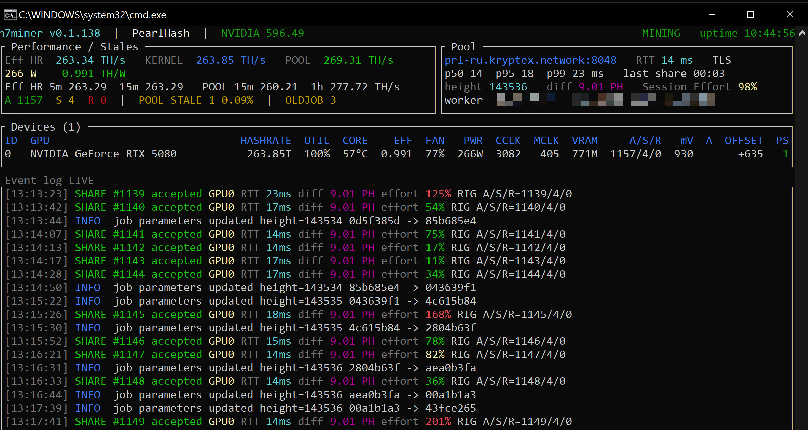
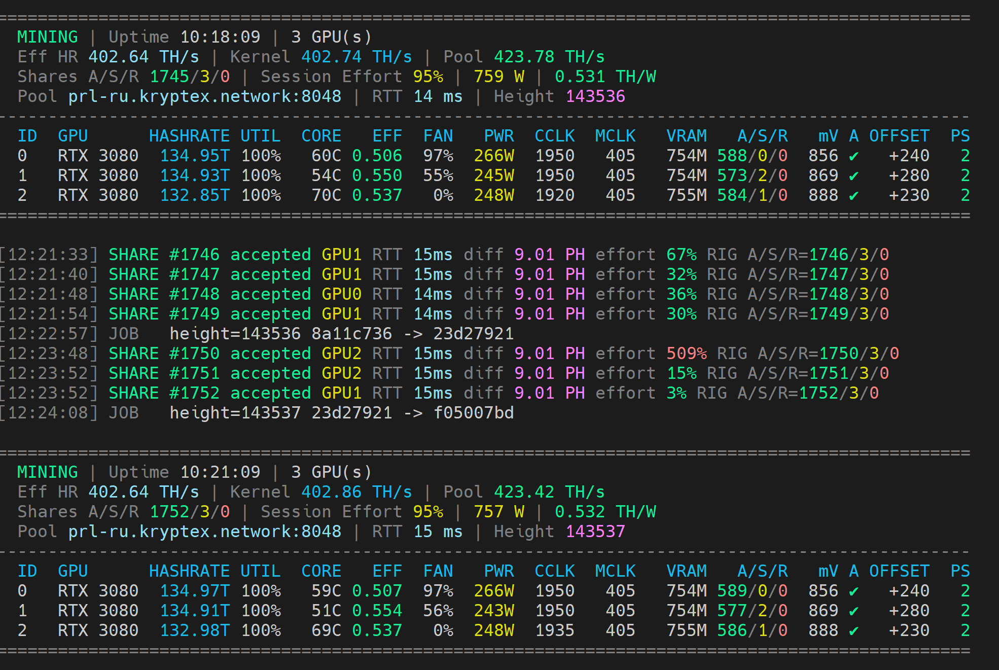

# N7Miner

**[Русский](README.md) · [English](README.en.md)**

N7Miner — майнер PearlHash для видеокарт NVIDIA и AMD. Работает на Windows, Linux и HiveOS. Можно запустить одну карту, целую ферму или вместе использовать NVIDIA и AMD.

**Windows x64 · Linux x64 · HiveOS · Комиссия разработчика 1%**

## Что изменилось в 0.1.139

- **Ampere (SM86 / RTX 30):** небольшое улучшение энергоэффективности майнинга.
- **AutoOC:** переработана обработка ошибок вычислений и восстановление работы отдельных GPU.
- **Bug fixes:** исправлены ошибки и улучшена стабильность.

## Скачать

| Система | Архив |
| --- | --- |
| Windows x64 | [N7Miner 0.1.139 для Windows](https://github.com/Nigh7man/N7Miner-Releases/releases/download/v0.1.139/N7Miner-v0.1.139-universal-windows-x64.zip) |
| Linux x64 | [N7Miner 0.1.139 для Linux](https://github.com/Nigh7man/N7Miner-Releases/releases/download/v0.1.139/N7Miner-v0.1.139-universal-linux-x64.tar.gz) |
| HiveOS | [N7Miner 0.1.139 для HiveOS](https://github.com/Nigh7man/N7Miner-Releases/releases/download/v0.1.139/n7miner-0.1.139_universal_hive_x64.tar.gz) |

[Все релизы](https://github.com/Nigh7man/N7Miner-Releases/releases) · [Последний опубликованный релиз](https://github.com/Nigh7man/N7Miner-Releases/releases/latest)

**Новости и обновления:** [Telegram-канал N7Miner](https://t.me/N7Miner).

Проверяйте архивы по файлу [SHA256SUMS.txt](https://github.com/Nigh7man/N7Miner-Releases/releases/download/v0.1.139/SHA256SUMS.txt).

# Что умеет N7Miner

- **Честный, проверяемый хэшрейт:** эффективную скорость можно сопоставить со статистикой пула за длительный интервал. На коротких промежутках показатели пула колеблются.
- **Прозрачная комиссия 1%:** никаких дополнительных скрытых удержаний майнера; возможная комиссия пула учитывается отдельно.
- **Оптимизированная хостовая часть:** быстрая обработка и отправка шар помогает уменьшать rejected и stale. На их количество также влияют сеть и пул.
- **NVIDIA и AMD:** работа с одной картой, несколькими GPU или смешанной фермой.
- **Power Save для NVIDIA:** уровни `--ps 0`–`--ps 3` для снижения энергопотребления. **По нашим тестам наибольший эффект — на RTX 50-й серии**, например RTX 5080. [Инструкция](docs/POWER-SAVE.md).
- **AutoOC:** автоматический подбор Core Clock Offset для NVIDIA с сохранением результата отдельно для каждой карты. [Инструкция](docs/AUTOOC.md).
- **Управление частотами и мощностью:** фиксация частот ядра и памяти, смещения и Power Limit в ваттах или процентах из командной строки; восстановление настроек при корректном завершении.
- **Защищённый Stratum TLS:** шифрованное соединение с пулом и проверка сертификата по умолчанию; резервные пулы с автоматическим переключением.
- **Мониторинг:** TUI и консоль с хэшрейтом, температурами, потреблением, эффективностью и статистикой шар по GPU; столбцы `A`, `OFFSET` и `PS`. Доступен локальный read-only API.
- **Стабильность и диагностика:** watchdog, проверка запуска и соединения, журнал событий.
- **CMP unlock для HiveOS:** экспериментальная проверка совместимости, разблокировка поддерживаемых CMP и возврат драйвера в исходное состояние. [Инструкция](docs/CMP-HIVEOS.md).

## Power Save

Режим NVIDIA Power Save доступен на Windows, Linux и HiveOS. Включается параметром `--ps 1` (уровни `0`–`3`). **Наиболее заметный эффект в наших тестах — на RTX 50-й серии.** На Linux/HiveOS нужны права `root`. [Гайд Power Save](docs/POWER-SAVE.md).

**Power Save протестирован на драйверах NVIDIA:** HiveOS — `610.43.03`, `615.71.10`; Windows — `596.49`, `621.24`. Тестирование на этих версиях не гарантирует совместимость с каждой моделью видеокарты.

## AutoOC

Режим `--autooc` сам подбирает offset ядра NVIDIA при залоченной частоте. Карты настраиваются по отдельности: майнер повышает offset небольшими шагами, откатывает его при ошибках и сохраняет найденные значения. В 0.1.139 переработаны учёт неверных вычислений и восстановление отдельной GPU.

Для запуска в HiveOS укажите **Lock Core Clock** и стартовый **Core Clock**, затем добавьте `--autooc` в `Extra config arguments`. В Windows используйте `--cclock`, `--coffset` и `--autooc`.

**Для PRL рекомендуем фиксировать память: предпочтительно 405 МГц, если карта и драйвер поддерживают этот режим; иначе — 810 МГц.**

**[Инструкция AutoOC на русском: настройка, этапы подбора, значки, ошибки и сброс](docs/AUTOOC.md)**

## Как выглядит

### Режим TUI

Для корректного значения `Eff HR` дайте майнеру поработать хотя бы 10–15 минут.

### Консольный режим

Если нужен обычный вывод в консоль вместо TUI:

~~~bash
n7miner --notui --log-interval 180
~~~

## Как запустить

### Windows

Распакуйте архив, откройте BAT-файл своего пула и укажите адрес кошелька. Можно запустить и вручную:

~~~bat
n7miner.exe -a pearlhash -o prl-ru.kryptex.network:7048 -u YOUR_WALLET -w rig01 -p x -d auto
~~~

Вместо `YOUR_WALLET` вставьте адрес кошелька Pearl. `rig01` — имя воркера, его можно поменять.

Если в ферме есть и NVIDIA, и AMD:

~~~bat
n7miner.exe -a pearlhash -o prl-ru.kryptex.network:7048 -u YOUR_WALLET -w rig01 --devices all --amd-devices all
~~~

### HiveOS

В HiveOS майнер добавляется как Custom Miner. Готовые настройки для нескольких пулов есть в [инструкции по HiveOS](docs/HIVEOS.ru.md).

Все параметры запуска, настройки частот и диагностические команды собраны в [справке по командной строке](docs/CLI.md).

## Хэшрейт на проверенных картах

Актуальные замеры N7Miner 0.1.138 от 15.11.2026:

| Видеокарта | Хэшрейт | Потребление GPU |
| --- | ---: | ---: |
| NVIDIA GeForce RTX 5080 | ~263 TH/s | ~266 Вт |
| NVIDIA GeForce RTX 3080 Ti | ~151–160,1 TH/s | ~253–323 Вт |
| NVIDIA GeForce RTX 3080 | ~133–135 TH/s | ~247–263 Вт |
| NVIDIA CMP 90HX | ~106,9 TH/s | ~246 Вт |
| NVIDIA GeForce RTX 3070 | ~89 TH/s | ~161 Вт |
| NVIDIA GeForce RTX 3070 Ti Laptop GPU | ~82 TH/s | ~75 Вт |
| NVIDIA GeForce RTX 3070 Laptop GPU | ~72–75 TH/s | ~82–115 Вт |
| NVIDIA RTX A3000 Laptop GPU | ~55,3 TH/s | ~119 Вт |
| AMD Radeon RX 6600 XT | ~11,5 TH/s | ~60 Вт |
| AMD Radeon RX 6600M | ~9,5 TH/s | ~50 Вт |
| AMD Radeon RX 5700 XT | ~3,9 TH/s | ~105 Вт |

## Проверка скачанных файлов

Сверьте SHA-256 скачанного архива с `SHA256SUMS.txt` из релиза. Команды для проверки (подставьте имя скачанного файла):

**Windows:** `Get-FileHash .\N7Miner-v0.1.139-universal-windows-x64.zip -Algorithm SHA256`

**Linux:** `sha256sum N7Miner-v0.1.139-universal-linux-x64.tar.gz`

Если майнер работает неправильно, [создайте Issue на GitHub](https://github.com/Nigh7man/N7Miner-Releases/issues) или напишите в комментариях [Telegram-канала N7Miner](https://t.me/N7Miner). Укажите версию майнера, модель GPU, драйвер, пул и приложите нужный фрагмент лога. Не публикуйте пароли и приватные ключи.

N7Miner распространяется «как есть», без каких-либо гарантий.
